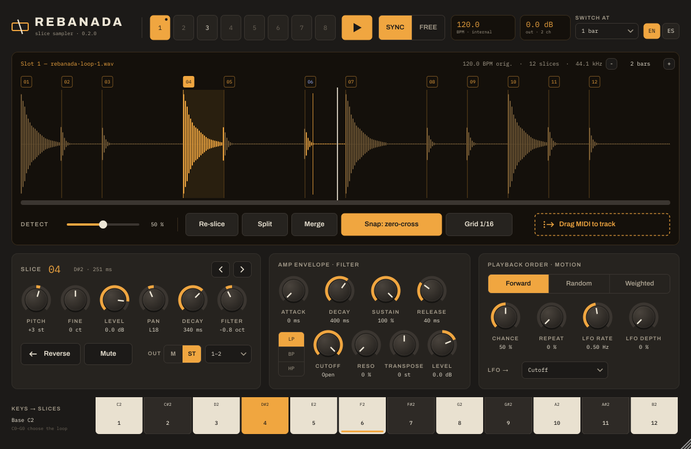

# Rebanada

**Sampler de rebanadas** para VST3, CLAP, AU y como aplicación independiente, en macOS y Windows, en el espíritu del Dr. OctoRex de Reason.

Rebanada corta un archivo de audio en rebanadas (detectando sus ataques o con una grilla), las toca en orden siguiendo el tempo del anfitrión o en el tiempo propio del loop, y deja tocar cada rebanada desde una nota MIDI. Cada rebanada tiene su altura, nivel, paneo, caída, filtro, sentido y canal de salida (hasta 64). Guarda hasta ocho loops, cada uno con su propia envolvente, filtro, orden y LFO, y cambia entre ellos en el pulso, en el compás o al final del loop.



## Descargar e instalar

1. Entrá a **[Releases](../../releases)** y bajá el paquete de tu sistema: `Rebanada-…-macOS.zip` o `Rebanada-…-Windows.zip`.
2. Descomprimilo y seguí las instrucciones del archivo `LEEME.txt` que viene adentro. Hay un instalador para cada sistema.

Las versiones de prueba, que todavía no se publicaron como Release, están en la pestaña **[Actions](../../actions)**: abrí la última compilación exitosa y bajá el paquete desde *Artifacts* (hace falta una cuenta de GitHub).

## Novedades de la 0.2

- **Cada loop tiene sus propios ajustes**: modo, velocidad, envolvente, filtro, orden, LFO, transposición y nivel. En el DAW aparecen como parámetros separados («L1 Cutoff», «L2 Cutoff»…), cada uno con su propia automatización.
- **64 canales**: cada rebanada elige si sale por un canal (**M**) o por un par (**ST**), entre 64. En Reaper, alcanza con darle más canales a la pista.
- **Zoom** en la forma de onda: rueda del mouse o pellizco en el trackpad, centrado en el cursor. Mayúsculas+rueda, o la barra de abajo, para desplazarse; doble clic en la barra para ver todo.
- **Salida general** en el encabezado, arrastrable como el tempo.
- Las sesiones de la 0.1 se abren con sus valores: los ajustes que eran comunes pasan a todos los loops y los pares de salida se convierten en canales.

## Cómo se usa

- **Cargar**: soltá uno o varios archivos de audio sobre la ventana (WAV, AIFF, FLAC, Ogg; en Mac también MP3 y otros), o hacé clic en la pantalla vacía. Soltados sobre los botones de loop, van a ese loop y los siguientes. Clic derecho en un botón de loop: cargar o vaciar.
- **Rebanar**: *Detect* ajusta la sensibilidad de la detección de ataques (más alto, más rebanadas). *Grid 1/16* corta en dieciseisavos según la cantidad de compases. *Snap: zero-cross* lleva cada corte al cruce por cero más cercano, para que las rebanadas empiecen sin clic.
- **Editar los cortes**: arrastrá un marcador para moverlo, doble clic para crear uno, clic derecho sobre un marcador para borrarlo. *Split* divide la rebanada elegida y *Merge* la une con la siguiente. La rueda del mouse acerca y aleja la forma de onda.
- **Compases**: los botones − y + de la pantalla fijan cuántos compases dura el loop; de eso depende cómo se acomoda al tempo en modo *Sync*.
- **Reproducción**: con *Play* encendido, el loop suena mientras el anfitrión reproduce (en la aplicación independiente, siempre, con el tempo que se arrastra en la pantalla de BPM).
  - *Sync*: cada rebanada empieza en su lugar dentro de los compases del anfitrión. Las rebanadas conservan su altura: si el tempo es más lento quedan huecos, si es más rápido se recortan.
  - *Free*: el loop corre en su propio tiempo; *Rate* (arrastrando la pantalla) lo acelera o lo frena sin cambiar la altura.
- **Notas MIDI**: Do2 (C2) toca la rebanada 1, Do#2 la 2, y así sucesivamente. Do0 a Sol0 (C0–G0) eligen los loops 1 a 8. Las teclas de la interfaz también tocan las rebanadas.
- **Drag MIDI to track**: arrastralo a una pista para tener el loop como notas, una por rebanada. Con *Play* apagado, esas notas tocan el loop y se pueden reordenar, cuantizar o cambiar.
- **Idioma**: botones EN / ES. Los parámetros aparecen en inglés en el DAW.

## Parámetros

### Por rebanada (se guardan con la sesión)

| Parámetro | Qué hace |
|---|---|
| Pitch / Fine | Transposición en semitonos (±24) y en cents (±50). |
| Level | Nivel de la rebanada (−36 a +6 dB). |
| Pan | Posición estéreo. |
| Decay | Acorta la rebanada con un desvanecimiento. Al máximo, suena entera. |
| Filter | Corre la frecuencia de corte del filtro para esta rebanada (±4 octavas). |
| Reverse | La rebanada suena al revés. |
| Mute | La rebanada no suena (ni en el loop ni con su nota). |
| Out | **M**: un canal (1 a 64). **ST**: un par de canales (1–2 a 63–64), con su paneo. |

### Generales (automatizables)

| Parámetro | Qué hace |
|---|---|
| Play | Reproducción del loop. |
| Switch at | Cuándo cambia el loop: inmediatamente, en el pulso, en el compás o al final del loop. |
| Tempo | Tempo cuando no hay transporte del anfitrión. |
| Output | Nivel de salida de todos los loops. |

### Por loop (automatizables, de «L1» a «L8»)

| Grupo | Parámetro | Qué hace |
|---|---|---|
| Tiempo | Mode | *Sync* (tempo del anfitrión) o *Free* (tiempo propio). |
| | Rate | Modo libre: velocidad del reloj del loop (0,25 a 4). |
| Envolvente | Attack, Decay, Sustain, Release | Envolvente de amplitud de cada rebanada. |
| Filtro | LP / BP / HP, Cutoff, Reso | Filtro de cada rebanada. *Cutoff* al máximo con LP lo deja abierto. |
| Nivel | Transpose, Level | Transposición y nivel del loop. |
| Orden | Forward / Random / Weighted | En orden, al azar, o en orden con una proporción (*Chance*) de pasos que tocan otra rebanada. |
| | Repeat | Probabilidad de que un paso repita la rebanada anterior. |
| Movimiento | LFO rate, LFO depth, LFO → | LFO hacia el corte, la altura, el paneo o el nivel. |

## Salidas separadas

Rebanada usa tantos canales como tenga la pista, hasta 64; el encabezado muestra cuántos. En Reaper, poné «Track channels» de la pista en la cantidad que quieras, elegí en cada rebanada su canal o su par, y mandá esos canales a otras pistas (por ejemplo, cada una con su Baraja) desde el botón de enrutamiento de la pista. Si una rebanada apunta a un canal que la pista no tiene, suena por 1–2.

## Compilar

Hace falta CMake 3.22 o posterior y un compilador de C++17. JUCE y las extensiones CLAP se descargan solas.

```
cmake -B build -DCMAKE_BUILD_TYPE=Release
cmake --build build --config Release
ctest --test-dir build -C Release
```

Con `-DREBANADA_SNAPSHOT=ON` se compilan además una prueba que carga el VST3 como un DAW y una herramienta que guarda una captura de la interfaz (`rebanada_snapshot captura.png es`).

## Licencia

GNU AGPL 3.0 o posterior. Usa [JUCE](https://juce.com) (AGPL), las fuentes Archivo e IBM Plex Mono (SIL Open Font License, en `Resources/fonts`) y [clap-juce-extensions](https://github.com/free-audio/clap-juce-extensions).
